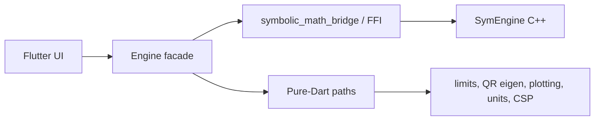

# CrispMath

An offline-first mathematical workspace: a scientific and graphing calculator
with a real computer-algebra system, a linked notepad, and documents that
survive between sessions. Built with Flutter, it runs natively on iOS, macOS,
Android, Windows and Linux, and in the browser through WebAssembly.

Everything that computes runs on the device. There is no account, no server
round-trip and no telemetry in the calculation path — symbolic algebra, exact
constants, statistics, plotting and OCR all execute locally.

**[Open the web app](https://crisp-math.vercel.app)** ·
**[Mirror on GitHub Pages](https://crispstrobe.github.io/CrispMath/)** ·
**[Releases](https://github.com/CrispStrobe/CrispMath/releases)** ·
**[TestFlight](https://testflight.apple.com/join/E6HdVhTx)**

Current version: <!-- AUTO:app_version -->1.2.0<!-- /AUTO:app_version -->;
`pubspec.yaml` carries build <!-- AUTO:build_number -->27<!-- /AUTO:build_number -->.
Latest release tag: <!-- AUTO:latest_tag -->v1.2.0<!-- /AUTO:latest_tag -->.
The App Store binary can trail the tag by a build number when it is rebuilt for
a release-blocking fix — see [HISTORY.md](HISTORY.md).

---

## Highlights

- **Symbolic algebra on every platform, including the browser** — SymEngine
  through FFI natively and through a WebAssembly worker on the web, replacing
  the usual "numeric only" web calculator.
- **Worksheets, not just answers** — a notepad with variables, cross-references,
  subtotals and sections, whose expressions can be linked to graph slots so
  changing a definition redraws the curve.
- **Graphs you can interrogate** — trace curves by touch or keyboard, read value
  tables, fit samples, set axis bounds, annotate roots and extrema, and undo.
- **On-device math OCR** — photograph or handwrite a formula and edit the
  recognised LaTeX before it is evaluated.
- **Reproducible state** — checkpoints, document history, portable worksheet
  bundles and backups, so a calculation can be revisited rather than retyped.

---

## Features

### Calculation and computer algebra

Expressions are entered in LaTeX with live rendering and are evaluated by the
SymEngine-backed bridge (native) or its WASM build (web).

- **Algebra** — `expand`, `simplify` (with rational cancellation and trig
  identities), `factor` (univariate, plus multivariate via FLINT), `gcd`,
  `lcm`, polynomial division and quotient cancellation.
- **Calculus** — symbolic `diff` (including nth order), indefinite and definite
  `integrate` (exact rational functions and improper exponential integrals),
  `limit` via L'Hôpital plus Gruntz-style growth-rate analysis, Taylor/Maclaurin
  `taylor`, and `dsolve` for first-order and constant-coefficient second-order
  ODEs with a step trace.
- **Solving** — `solve` for equations, polynomial and rational equations,
  polynomial inequalities, complex quadratics, and linear systems through
  `linsolve`.
- **Number theory** — `factorial`, `fibonacci`, `isprime`, `factorint`,
  `nextprime`, `prevprime`, `divisors`.
- **Special functions and constants** — `erf`, `beta`, Bessel J/Y, and the exact
  constants `π`, `e`, `γ`.
- **Precision** — `evalf`, `e(N)`, `sqrt(2, N)` and `EulerGamma(N)` through
  MPFR-backed arbitrary precision.
- **Matrices** — literals, arithmetic, `det`, `inv`, `transpose`, `rref`,
  `eigenvalues` and `eigenvectors` (pure-Dart QR with Hessenberg reduction).
- **Vectors and tensors** — `dot`, `cross` and tensor helpers in pure Dart.
- **Boolean and constraint DSL** — `and`, `or`, `among`, `at_least`,
  `at_most`, `all_different`, `at_most_in_a_row`.

The full function reference (<!-- AUTO:function_entry_count -->130<!-- /AUTO:function_entry_count --> entries
with signatures, examples, expected results and cross-links) is available
inside the app.

### Units, dates and everyday arithmetic

- Unit-aware arithmetic with SI prefixes, derived units (N, J, W, Pa, Hz) and
  composite dimensions — `100 m / 10 s` evaluates to `10 m/s`.
- Offline currency conversion across 44 currencies.
- Date and time arithmetic in the notepad.

### Statistics

Descriptive statistics with preset column layouts, linear, polynomial and
exponential regression, normal and binomial distributions, and nine hypothesis
tests: one/two-sample and paired t-tests, one-way ANOVA, chi-square
goodness-of-fit and independence, Fisher's exact test, sign test and Wilcoxon
rank-sum. Data can be pasted from the clipboard.

### Graphing

- **2D plots** — `Y1…Y10` function slots, parametric `(x(t), y(t))`, polar
  `r(θ)`, implicit `F(x, y) = 0` via marching squares, and vector fields.
- **Interaction** — pan, pinch/scroll zoom, drag or arrow-key tracing,
  root/extrema annotations, parameter sliders, and a 20-change undo history.
- **Analysis** — editable axis bounds, reading values off a curve, exporting a
  sampled value table (CSV/TSV), and fitting finite samples where the outer 2%
  of samples is trimmed so isolated poles do not dominate the range.
- **Curve sketching** — a Kurvendiskussion pipeline that reports zeros,
  extrema, inflection points and symmetry.
- **3D** — `z = f(x, y)` as a rotated wireframe over a cached sample grid.
- **Geometry modules** — plane and conic-section analysis in the Analysis hub.
- **Links to documents** — a graph slot can be bound to a notepad expression and
  follows the document's variables.

### Worksheets and documents

The notepad is a multi-line evaluator rather than a scratchpad: variables,
cross-references, subtotals, collapsible sections, templates, inline
mini-plots and Markdown/LaTeX export. Rows otherwise stored per widget are
stored per document, so state survives tab switches and reloads.

- Checkpoints and document history let you compare a later state with an
  earlier one and restore it.
- Portable worksheet bundles carry results and plots for sharing and
  recalculation on import.
- Damaged document indexes are recovered, and legacy storage migrates without
  overwriting newer records.

### Constraints and puzzles

- **FlatZinc** parser and solver, reachable inline with the `fzn:` prefix, plus
  a step-by-step propagation view.
- **Sudoku** solver that explains each deduction (singles, locked candidates,
  subsets, Killer cage sums) and draws its search tree.
- **N-queens**, boolean constraint problems and magic squares.

### Handwriting and math OCR

Recognition runs on device through CrispEmbed's ggml inference — no Python and
no ONNX at runtime:

- **Printed math** — DeiT encoder with a TrOCR decoder, published in four
  quantization levels (F32/F16/Q8_0/Q4_K).
- **Handwritten math** — HMER and BTTR, auto-detected from the GGUF metadata.
- **Input** — camera capture or pen drawing, with the recognised LaTeX kept
  editable before evaluation.
- **Optional cloud fallback** — a configured vision-capable endpoint, only when
  you choose to use it.

Model weights with restrictive licenses are gated: the non-commercial Qwen
research model requires explicit, persisted consent that names the license,
can be withdrawn, and fails closed at inference time when absent.

### Optional AI assistance

CrispAssist is a verifier, narrator and translator — never a silent solver.
It is off until you configure an Anthropic-compatible or OpenAI-compatible
endpoint, streams responses, supports cancellation, timeout and retry, and
shows every translated expression for review before it is calculated. Keyless
local endpoints are supported; browser endpoints must allow CORS. A configured
endpoint is not a claim that a model connection has been verified.

### Workspace, layout and accessibility

- **Adaptive layout** — bottom navigation below 720 px, a side rail from 720 px,
  and a two-pane split from 1200 px so the calculator and a graph can be visible
  together.
- **Command palette** — `Ctrl`/`Cmd`+`K` searches screens, tools and function
  examples; arrow keys and Enter work throughout.
- **Keyboard** — hardware input, calculator shortcuts and trace controls.
- **Accessibility** — high-contrast theme, 80–150 % text scaling, semantic
  labels on controls and a keyboard-reachable result path.
- **Localization** — English, German, French and Spanish, including function
  reference entries and worked examples.
- **Export** — PDF, Markdown, LaTeX, JSON workspace state and CSV history, plus
  shareable `?expr=…&tab=N` links.

### Performance

Modules mount on first visit and keep their state; hidden graphs stop sampling.
Graph geometry is sampled off the paint path — an isolate natively, and a
persistent browser worker with its own WASM instance on the web, so cancelling a
calculation does not interrupt a plot. Viewport and expression caches are
bounded, and a settings overlay reports UI and raster p95 work times against the
display refresh budget.

---

## Platform support

| Platform | Symbolic engine | Notes |
|---|---|---|
| **iOS** | ✓ full | `.xcframework`; App Store build in review |
| **macOS 12+** | ✓ full | `.xcframework`, release artifacts unsigned |
| **Android arm64-v8a** | ✓ full | `libsymbolic_math_bridge.so`; APK unsigned |
| **Windows x86_64** | ✓ full | `libsymbolic_math_bridge.dll` in a self-contained bundle |
| **Linux x86_64** | ✓ full | GLIBC 2.35 baseline; statically built SymEngine |
| **Web** | ✓ full via WASM | SymEngine compiled to WebAssembly (GMP/MPFR/MPC/FLINT) |

Android `x86_64` and `armeabi-v7a` are not built. The only capability gap
specific to the web build is multivariate factoring, which falls back to
`expand`.

---

## Install

**Web** — open [crisp-math.vercel.app](https://crisp-math.vercel.app). Both web
hosts serve the same bundle; GitHub Pages lags at most one deploy behind.

**Desktop** — download from the [release page](https://github.com/CrispStrobe/CrispMath/releases):
`.zip` for macOS and Windows, `.tar.gz` for Linux. Builds are unsigned, so
macOS needs right-click → Open the first time.

**iOS** — join the [public TestFlight](https://testflight.apple.com/join/E6HdVhTx).
The current App Store submission is in review.

**Android** — install the unsigned APK from the release page
(`adb install crisp_math-v<!-- AUTO:app_version -->1.2.0<!-- /AUTO:app_version -->-android.apk`).

---

## Build from source

Requirements: Flutter **<!-- AUTO:flutter_version -->3.44.0<!-- /AUTO:flutter_version -->** (stable), Python 3.12 for the
packaging and verification scripts, and a platform toolchain for native builds.

```bash
# 1. The OCR/runtime plugin is consumed from a pinned checkout, as CI does.
git clone https://github.com/CrispStrobe/CrispEmbed.git .ci/CrispEmbed
git -C .ci/CrispEmbed checkout --detach <!-- AUTO:crispembed_revision -->d28ca2ea43a95934d673d1a54177fdf721614ade<!-- /AUTO:crispembed_revision -->

# 2. Resolve dependencies (points the plugin at that checkout).
cat > pubspec_overrides.yaml <<'YAML'
dependency_overrides:
  crispembed:
    path: .ci/CrispEmbed/flutter/crispembed
YAML
flutter pub get

# 3. Stage the matching native OCR runtime for desktop builds.
python3 tool/stage_ocr_runtime.py --platform linux   # or macos / windows

# 4. Build and check.
flutter analyze
flutter test
flutter run

# 5. Browser bundle (also compiles the CAS worker).
tool/build_web.sh --release
```

The native CAS lives in the `symbolic_math_bridge` plugin, a separate
git-pinned repository; see its README for the SymEngine build.

### Release process

Pushing a `v*` tag triggers `.github/workflows/release.yml`, which validates the
label against `pubspec.yaml` and the dependency lock, builds all six platforms,
checks the macOS binary for exported SymEngine symbols, and publishes the
artifacts with a dependency manifest. `main` pushes deploy the web preview to
GitHub Pages; tags deploy Vercel production.

### Pinned versions

Generated from `pubspec.yaml` and `tool/dependency_lock.json` by
`tool/update_readme_facts.py`; do not edit these rows by hand.

| Component | Pin |
|---|---|
| CrispMath | <!-- AUTO:app_version_build -->1.2.0+27<!-- /AUTO:app_version_build --> |
| Latest release tag | <!-- AUTO:latest_tag -->v1.2.0<!-- /AUTO:latest_tag --> |
| Flutter | <!-- AUTO:flutter_version -->3.44.0<!-- /AUTO:flutter_version --> |
| CrispEmbed runtime | <!-- AUTO:crispembed_revision -->d28ca2ea43a95934d673d1a54177fdf721614ade<!-- /AUTO:crispembed_revision --> |
| `symbolic_math_bridge` | <!-- AUTO:bridge_revision -->e75dbbe916c238e6a109ba85aac227fe9bbe34b7<!-- /AUTO:bridge_revision --> |
| `dart_csp` | <!-- AUTO:dart_csp_version -->2.3.0 (ce10138)<!-- /AUTO:dart_csp_version --> |

---

## Architecture

Three layers, with a strict boundary at the engine:

1. **Flutter UI** (`lib/screens`, `lib/widgets`) — rendering, input and layout;
   it never touches FFI.
2. **Engine facade** (`lib/engine`) — `CalculatorEngine` and the dispatchers.
   Every operation returns a `String`, so errors and results share one path;
   when no native library is present, calls return
   `'Error: <op> requires native library'` instead of crashing, which is what
   lets the whole suite run under `flutter test`.
3. **`symbolic_math_bridge`** — an FFI plugin over the SymEngine C API, with a
   WebAssembly build for the browser.



Pure-Dart implementations deliberately cover what must run synchronously or on
the web worker: numeric fallback, limits, eigenvalue decomposition, plot
sampling, unit and currency arithmetic, statistics and the constraint solver.

```
lib/
├── engine/          # CAS facade, solvers, statistics, units, CSP, OCR catalog
├── screens/         # calculator, graphing, analysis hub, statistics, notepad,
│                    # constraints, Sudoku, 3D, conic/plane analysis
├── services/        # workers, AI provider, OCR, documents, backups, sync
├── widgets/         # keypad, displays, dialogs, palettes, drawing canvas
├── localization/    # en / de / fr / es
├── utils/           # LaTeX conversion, preprocessing, keyboard mapping
└── main.dart        # app shell, settings, adaptive layout

tool/                # packaging, browser/native checks, benchmarks, release gates
integration_test/    # end-to-end and corpus tests
native_test/         # native OCR, CAS corpus cross-check, inference quality
docs/                # audits, findings and per-release evidence
```

---

## Privacy and data

- Calculations, OCR and inference run locally; the app needs no account.
- Cloud sync and backup exist but are **off unless you configure them**
  yourself; the browser build is checked in CI to emit no backend requests
  unconfigured. No production backend is selected.
- Nothing is uploaded except what you explicitly send to an AI or cloud OCR
  endpoint you configured.
- Third-party licenses ship in `assets/licenses`.

---

## Validation

The repository treats behaviour, not compilation, as the deliverable:

- **<!-- AUTO:test_file_count -->273<!-- /AUTO:test_file_count --> test files** across unit, widget, integration and native suites.
- **789 accumulated math cases** audited independently across native Linux,
  WebAssembly and packaged macOS, plus 52 round-eleven references exercised
  through real desktop and phone UI checks — see `docs/round11-math-audit-52.md`.
- **Browser checks** for the deployed bundle: worksheets, linked graphs,
  tracing, exports, document history, OCR runtime, cloud-off behaviour and the
  guided worksheet flow, run against Pages and Vercel on every deploy.
- **Native checks** for the installed OCR runtime (a committed `5 + 7` image
  must evaluate to `12`), CAS corpus parity and inference quality.
- **Release gates**: the macOS binary is rejected unless the required SymEngine
  symbols are present, and iOS uploads are refused unless the packaged source
  matches a green validation run and the build number is unused.

```bash
python3 tool/cas_corpus_verify.py                                  # certify corpus
flutter test test/cas_corpus_test.dart                             # Dart fallbacks
flutter test integration_test/cas_corpus_native_test.dart -d macos  # native
CRISPMATH_OCR_MODEL=… CRISPMATH_OCR_LIBRARY=… \
  flutter test native_test/ocr_native_test.dart                    # real OCR
```

---

## Known limitations

- `limit()` is a pure-Dart implementation (L'Hôpital plus growth-rate analysis),
  not a SymEngine binding.
- Eigenvalues/eigenvectors use a pure-Dart QR algorithm — fine to 4×4, not
  optimised beyond it.
- `simplify()` covers the core identities (Pythagorean, double angle, power
  reduction, secant form); broader rewriting (angle sums, half angles, radicals)
  is still open.
- Multivariate `factor()` needs FLINT and is unavailable in the web build.
- Handwriting recognition is experimental: the original benchmark recognises
  7 of 50 samples, and recognition quality is reported separately from build and
  contract tests. Printed math is markedly better.
- 3D graphing is a wireframe `z = f(x, y)` with cached sampling; perspective,
  hidden-line removal and contour lines are not implemented.
- OCR requires the bundled CrispEmbed runtime for the platform.
- Physical-device testing is not yet recorded for the current release.
- The Qwen2.5-VL-3B OCR weights are under a non-commercial research license and
  stay behind explicit consent; they are not a general-purpose asset.

---

## Documentation

| Document | Contents |
|---|---|
| [docs/current-state-and-next-steps.md](docs/current-state-and-next-steps.md) | verified state of every surface, open lanes |
| [HISTORY.md](HISTORY.md) | dated record of what landed and its evidence |
| [PLAN.md](PLAN.md) | punch list and roadmap |
| [RELEASE_NOTES.md](RELEASE_NOTES.md) | current release notes |
| [docs/release-notes/](docs/release-notes/) | archived release notes |
| [DISTRIBUTION.md](DISTRIBUTION.md) | store submission checklist |
| [STORE_LISTING.md](STORE_LISTING.md) | listing copy and review notes |
| [docs/round11-math-audit-52.md](docs/round11-math-audit-52.md) | 789-case math evidence |

---

## License

GNU AGPL-3.0, with an additional permission under Section 7 allowing
distribution through app marketplaces whose terms would otherwise conflict with
Section 10 — provided the corresponding source stays available under the same
license. See [LICENSE](LICENSE).

Third-party components include Flutter, SymEngine (with GMP/MPFR/MPC/FLINT),
`dart_csp`, and the CrispEmbed runtime; their notices ship in
`assets/licenses`.
